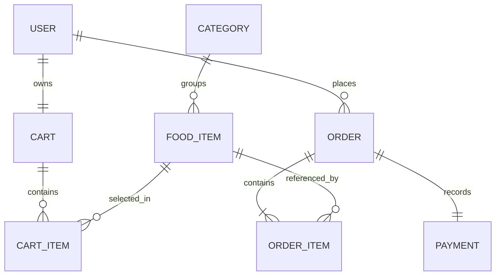

# Architecture and design notes

React calls Axios service methods. The API adapter converts backend enum/DTO representations into UI models. AuthContext stores only the in-memory access token/user and synchronized cart state. Spring controllers validate request DTOs, services enforce ownership/business rules/transactions, repositories execute JPA persistence operations, and MySQL stores records. Responses are DTOs rather than JPA entities, preventing password leakage, recursive relationships and lazy loading outside transactions.

## Entity decisions

- `User`: ADMIN/CUSTOMER, BCrypt password hash and unique normalized email.
- `Cart`: one-to-one with User, unique user_id.
- `CartItem`: many-to-one with Cart/FoodItem, unique cart_id + food_id.
- `Category`: one-to-many with FoodItem.
- `FoodItem`: price as BigDecimal, enum availability, soft deletion.
- `CustomerOrder`: Java/table names avoid SQL reserved word ORDER. Owns order lines and payment.
- `OrderItem`: references original food but snapshots name, image and unit price.
- `Payment`: one-to-one with order, exact amount and status.

The migration adds foreign keys, unique constraints, quantity/enum checks and indexes. `ddl-auto=validate` checks the entity/schema match; Flyway owns schema evolution.

## Transactions and consistency

Cart mutations and checkout acquire a pessimistic lock on the customer's cart. Checkout validates the current persisted food records, computes authoritative totals, writes order/items/payment and clears the cart atomically. The unique user_id/request_key constraint and repeated-key lookup support safe request retries. A rollback keeps the original cart intact.

Status transitions are enforced in the service, not trusted from a dropdown. Only approved transitions are accepted. Order and payment changes lock the order row so these operations share one serialization point.

## Authentication boundaries

Registration cannot select a role. Initial ADMIN bootstrap requires an environment-provided password. JWTs use HMAC SHA-256 with a minimum 32-byte secret, issuer validation and expiration. Secrets are not committed. Real-mode browser storage contains no access token; reload requires login. Logout is client-side token removal, with token validity bounded by expiry. This coursework does not implement refresh tokens or revocation lists.

Spring Security method guards enforce administrator functions. Services enforce resource ownership. CORS allows configured origins and does not serve as an authorization mechanism. CSRF is disabled because this is a stateless Authorization-header bearer-token API, not cookie-based authentication.

## Practical limits

- Coursework scale: list endpoints are not paginated.
- Cash-on-delivery records; no card gateway, dispatch integration or refunds.
- Stock is availability status, not a numeric inventory system.
- No email verification, password reset or token refresh requirement was specified.
- Browser sample images are external; the app can be adapted to local licensed assets.
- Docker configuration is for local coursework use. Public deployment needs HTTPS, managed secrets/backups and environment-specific hardening.
- MERN migration is an optional bonus and is not implemented.
